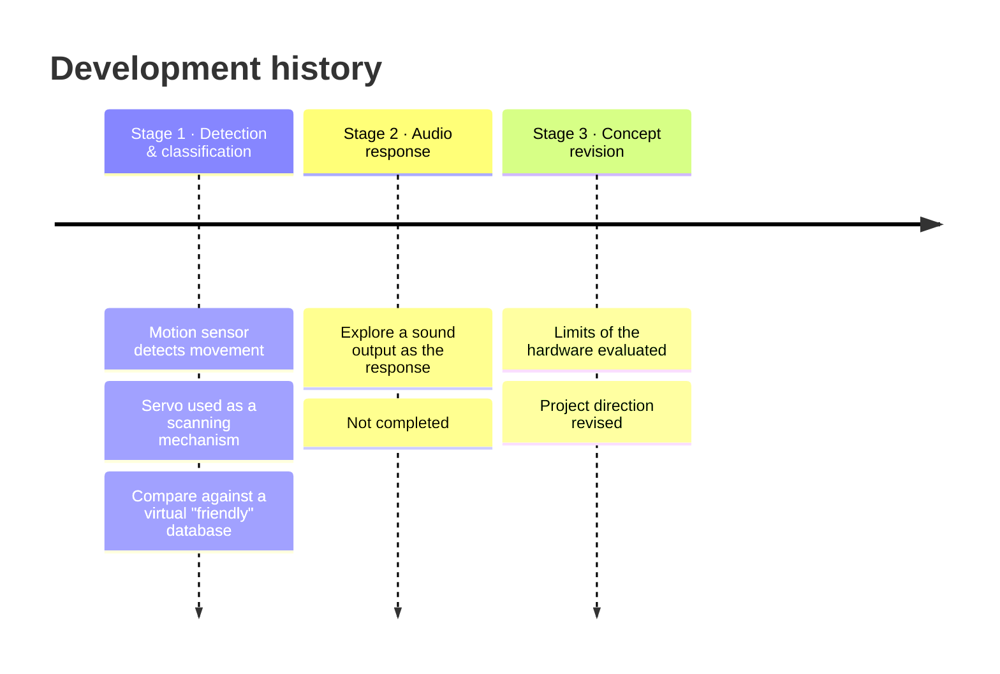
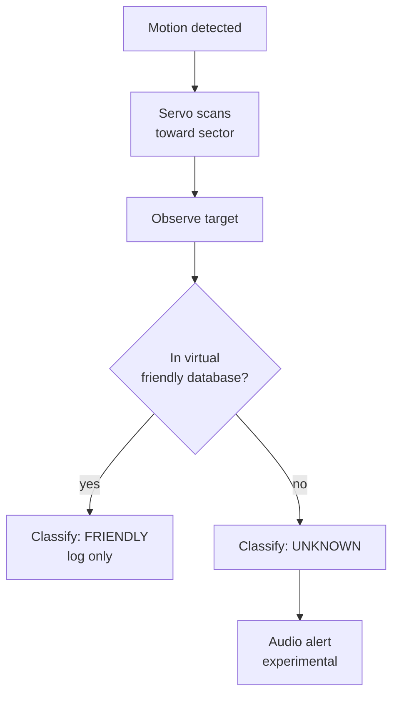

# ✈️ Aircraft Detection & Audio-Response Concept

> **An unfinished experiment, documented honestly.** I started out trying to detect and classify "aircraft" with an Arduino Nano, a servo and a motion sensor. The prototype was never finished. Working out why taught me more about sensors and system limits than a finished demo would have.

---

## Contents
1. [Project Overview](#1-project-overview) · 2. [Objective](#2-objective) · 3. [Components](#3-components) · 4. [Working Principle](#4-working-principle) · 5. [Circuit Design](#5-circuit-design) · 6. [Implementation](#6-implementation) · 7. [Source Code](#7-source-code) · 8. [Results](#8-results) · 9. [Challenges](#9-challenges) · 10. [Future Improvements](#10-future-improvements)

---

## 1. Project Overview

The idea: detect a moving object, scan toward it with a servo, check it against a list of "friendly" entities, and trigger an audio response if it's unknown. It was a scaled-down way of thinking about how detection-and-response systems are structured.

**Original experimental platform: Arduino Nano.**

The project went through three stages:

## 2. Objective

- Explore object detection with low-cost sensors.
- Try servo-based scanning.
- Design a basic classification flow: known vs unknown.
- Most importantly, **find the limits** of simple sensor-based detection.

## 3. Components

| Component | Role |
|---|---|
| Arduino Nano | Controller. Chosen for its small size. |
| Servo motor | Mechanical scanning / pointing |
| Motion sensor | Detects movement (exact model not confirmed; likely a PIR) |
| Potentiometer | Adjustable parameter (sensitivity / alert tone) |
| Audio output | Proposed experimental response (a piezo buzzer in the simulation) |
| Breadboard, power supply | |

## 4. Working Principle

### Intended logic

### What the hardware can actually do

This is where the concept ran into reality:

| The concept needed… | What the hardware actually provides |
|---|---|
| Target **identity** | A PIR only reports "infrared changed somewhere in my field of view": one bit |
| Target **type**, altitude, direction | None of these. There's no range or bearing information. |
| Radar-style scanning | A servo can **point** a sensor, but pointing a one-bit sensor doesn't create range or Doppler data |
| Friend-or-foe check | Real systems use **cooperative** identification: the aircraft actively transmits an ID (transponder / ADS-B). A passive motion sensor can't read that. |
| A "countermeasure" | A buzzer is an alert. It isn't RF, it affects nothing but the room, and it's in no way comparable to an electronic countermeasure. |

So the honest version of this project is a **detection-and-alert simulation**, and that's what the code below does.

## 5. Circuit Design

| Component | Nano pin |
|---|---|
| Motion sensor OUT | D2 |
| Potentiometer wiper | A0 |
| Piezo buzzer | D9 |
| Servo signal | D6 |

Diagrams for the concept are in [`Diagrams/`](Diagrams/).

## 6. Implementation

1. The motion sensor and servo were set up on the Nano as the detection and scanning stage.
2. The friendly / unknown decision was designed as a lookup against a predefined list.
3. The audio-response stage was explored but **not completed**.
4. After evaluating the hardware limits above, the concept was revised.

## 7. Source Code

Two sketches, both **simulations**:

| Sketch | What it shows |
|---|---|
| 📄 [`detection_alert_sim`](Code/detection_alert_sim/detection_alert_sim.ino) | Motion → servo sweep → buzzer alert. The potentiometer sets the alert tone (500–2000 Hz). |
| 📄 [`classification_sim`](Code/classification_sim/classification_sim.ino) | The "virtual database" idea: type a simulated target ID into the Serial Monitor and the system classifies it as FRIENDLY or UNKNOWN |

> These simulate a warning response only. They don't identify real aircraft and don't interact with any communication system.

## 8. Results

- ✅ Motion detection and servo response worked as a demo.
- ✅ The classification logic works when the target ID is *given* to it (simulated through Serial).
- ❌ The system **cannot** get a target ID from the physical world with this hardware.
- ❌ The audio-response stage was not completed.

## 9. Challenges

- **The gap between the concept and the hardware.** This was the real challenge. I had to separate what I *wanted* the system to do from what the sensors could *physically measure*.
- **One-bit sensing.** A PIR's output is binary. Every extra piece of information (where, how far, what) needs a different kind of sensor.
- **Knowing when to revise.** Stopping and changing direction was an engineering decision, not a failure to finish.

## 10. Future Improvements

If I came back to this as a sensing project:

- [ ] Replace the PIR with a **ranging** sensor (ultrasonic or a ToF LiDAR like the VL53L1X) on the servo, to make a real 2-D scan map.
- [ ] Plot servo angle vs measured distance as a radar-style polar display (Processing / Python).
- [ ] Split detection, classification and response into separate software modules.
- [ ] Log detection events with timestamps and plot a timeline.
- [ ] For real aircraft data, the cooperative route: receive public **ADS-B** broadcasts with an RTL-SDR, which is how aircraft actually identify themselves.

## References

See [`References/`](References/).
